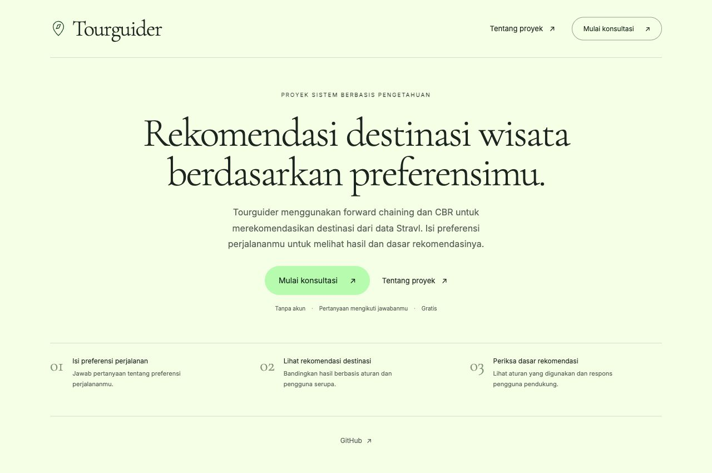
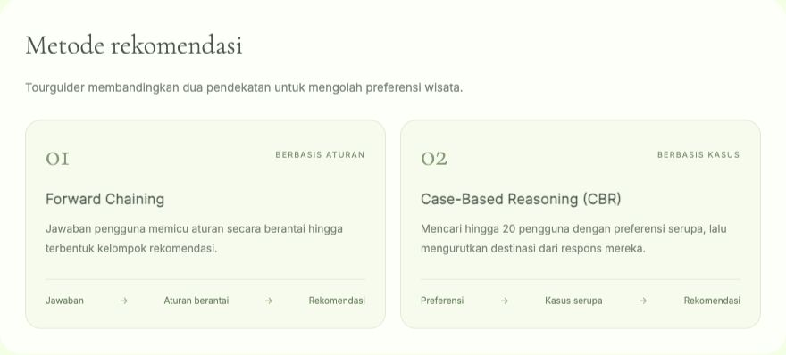

# Tourguider

**Tourguider** adalah proyek mata kuliah **Sistem Berbasis Pengetahuan** untuk merekomendasikan destinasi wisata berdasarkan preferensi pengguna. Aplikasi menggunakan **Forward Chaining** sebagai metode utama dan **Case-Based Reasoning (CBR)** sebagai pembanding, dengan dataset preferensi wisata dari Stravl.

Pengguna menjawab pertanyaan yang mengikuti alur aturan, lalu melihat maksimal lima rekomendasi dari masing-masing metode beserta dasar pemilihannya.



## Fitur

- Konsultasi satu pertanyaan per langkah; pertanyaan berikutnya mengikuti cabang aturan yang aktif.
- Kesimpulan suatu aturan menjadi premis aturan berikutnya, dengan jejak penalaran yang dapat dilihat.
- Perbandingan rekomendasi berbasis aturan dan maksimal 20 kasus pengguna serupa.
- Bukti pendukung berupa jumlah respons **Ya**, **Mungkin**, dan **Tidak**.
- Perubahan jawaban menghitung ulang alur dan membersihkan kesimpulan dari cabang lama.
- Jawaban **belum tahu** tidak menjadi dasar kemiripan CBR. Jika tidak ada preferensi, aplikasi menampilkan daftar populer dengan penanda yang jelas.
- Halaman informasi proyek, ringkasan data, dan hasil validasi aktual.
- Tampilan berbahasa Indonesia yang dapat digunakan di laptop dan ponsel, tanpa akun.

## Teknologi

| Bagian | Teknologi |
|---|---|
| Antarmuka | HTML, CSS, dan JavaScript |
| Backend dan API | Python, FastAPI, dan Uvicorn |
| Pengolahan data | Pandas, NumPy, dan SciPy |
| Pembentukan aturan | Pohon keputusan dari scikit-learn |
| Penyimpanan model | Joblib |
| Pengujian | Pytest dan pengujian bawaan Node.js |

## Menjalankan di komputer lokal

Memerlukan **Python 3.11 atau lebih baru**. Proyek diuji menggunakan Python 3.14 di macOS dan Python 3.12.10 di Windows. Dataset, model terlatih, aturan, dan font sudah disertakan; koneksi internet diperlukan untuk mengunduh repositori dan memasang dependensi.

### 1. Unduh proyek

```bash
git clone https://github.com/nikokrisp/proto-tourguider.git
cd proto-tourguider
```

### 2. Buat lingkungan Python

```bash
python3 -m venv .venv
```

Aktifkan di **macOS/Linux**:

```bash
source .venv/bin/activate
```

Aktifkan di **Windows PowerShell**:

```powershell
.venv\Scripts\Activate.ps1
```

Di Windows, gunakan `python` apabila perintah `python3` tidak tersedia.

### 3. Pasang dependensi dan jalankan

```bash
python -m pip install -r requirements.txt
python -m uvicorn backend.app:app --host 127.0.0.1 --port 8765
```

Buka **[http://127.0.0.1:8765](http://127.0.0.1:8765/)** setelah server siap. Hentikan dengan `Ctrl+C` di terminal. Jalankan aplikasi melalui server ini; membuka `frontend/index.html` langsung tidak menjalankan mesin rekomendasi.

**Alternatif di macOS:** dari folder proyek, jalankan `zsh run.command`. Skrip akan menyiapkan dependensi pada pemakaian pertama dan menjalankan aplikasi. Jika port 8765 sedang digunakan, perintah Uvicorn dapat memakai `--port 8766`.

## Metode rekomendasi



### Forward Chaining

Pohon keputusan dibentuk dari pasangan profil pengguna dan destinasi yang diberi respons Ya. Setiap pengguna memiliki total bobot yang sama. Cabang pohon diekstrak menjadi aturan berantai; mesin inferensi menjalankan aturan tersebut dari fakta jawaban sampai mencapai kelompok rekomendasi.

Model saat ini memiliki **94 aturan** dan **32 kelompok akhir**, dengan kedalaman pohon maksimal lima. Fakta kesimpulan cabang menjadi premis aturan berikutnya. Pertanyaan hanya muncul ketika fakta tersebut diperlukan oleh cabang aktif.

### Case-Based Reasoning

CBR mencari maksimal **20 pengguna serupa** dengan cosine similarity, hanya dari preferensi yang sudah diisi. Respons Ya, Mungkin, dan Tidak diberi nilai 1, 0,5, dan 0, lalu dibobotkan dengan kemiripan kasus.

Kecocokan CBR memerlukan minimal satu respons Ya dari kasus serupa. Destinasi yang hanya ditolak kasus serupa dikeluarkan. Jika dukungan tidak mencukupi, daftar dapat dilengkapi dari popularitas pada data pelatihan dengan label **Alternatif populer**. Aplikasi ini memakai basis kasus tetap; jawaban baru tidak disimpan sebagai kasus pelatihan.

## Dataset dan validasi

Dataset awal berisi **80.301 profil**, **38 kolom**, dan **1.486 destinasi**. Setelah penghapusan rekaman identik, swipe berulang, pasangan berlabel bertentangan, dan rekaman tanpa interaksi bersih, terdapat **61.130 profil** yang digunakan.

Data dibagi berdasarkan pengguna: **48.904 untuk pelatihan** dan **12.226 untuk pengujian**, dengan seed 42. Sebanyak **9.457 pengguna uji** memenuhi kriteria evaluasi: minimal lima kandidat berlabel Ya/Tidak dan minimal satu Ya.

| Metode | Ketepatan 5 hasil | Cakupan 5 hasil | Kualitas urutan 5 hasil |
|---|---:|---:|---:|
| Forward Chaining | 56,86% | 56,57% | 66,17% |
| CBR | 56,70% | 56,93% | 65,04% |
| Popularitas sebagai pembanding | 56,95% | 56,62% | 66,10% |

Ketiga ukuran tersebut adalah Precision, Recall, dan NDCG pada lima rekomendasi teratas. Evaluasi menggunakan destinasi yang telah dinilai oleh pengguna uji; destinasi tanpa penilaian tidak dianggap negatif. Angka ini mengukur pemeringkatan dalam dataset dan tidak menyatakan persentase kepuasan perjalanan nyata.

Pemeriksaan yang sudah dijalankan: **22 tes backend, 3 tes frontend, dan 17 pemeriksaan independen data/perhitungan**. Seluruh 61.130 profil diperiksa untuk kesetaraan antara pohon sumber dan mesin aturan. Rincian tersedia pada [laporan validasi](AUDIT.md).

## Struktur proyek

```text
proto-tourguider/
├── backend/             # API, pertanyaan, aturan, CBR, pelatihan, dan audit
├── frontend/            # HTML, CSS, JavaScript, serta font lokal
├── data/
│   ├── raw/             # Dataset Stravl asli dan pemetaan destinasi
│   └── processed/       # Ringkasan pembersihan dan pembagian pengguna
├── artifacts/           # Model terlatih, aturan, evaluasi, dan bukti audit
├── tests/               # Pengujian backend dan frontend
├── docs/                # Metodologi dan gambar dokumentasi
├── requirements.txt
├── requirements-dev.txt
├── run.command
└── AUDIT.md
```

## Pengujian dan pelatihan ulang

## Pengujian dan Pelatihan Ulang

Setelah lingkungan virtual Python diaktifkan, instal dependensi pengembangan dan jalankan pengujian backend:

```bash
python -m pip install -r requirements-dev.txt
python -m pytest -q
```

Pengujian frontend memerlukan Node.js. Jalankan perintah berikut untuk mengeksekusi pengujian regresi frontend:

```bash
node --test tests/frontend_regression.cjs
```

Untuk membentuk ulang model dan menghitung ulang hasil evaluasi, jalankan kedua perintah berikut secara berurutan:

```bash
python -m backend.train
python -m backend.audit --write-evaluation
```

Pada lingkungan Windows tertentu, jika terjadi `UnicodeDecodeError`, aktifkan mode UTF-8 di Git Bash sebelum menjalankan pelatihan dan evaluasi:

```bash
export PYTHONUTF8=1
```

Mulai ulang server setelah pelatihan agar model baru dimuat. Penjelasan pengodean fitur, rumus CBR, API, dan batasan evaluasi tersedia pada [dokumentasi metodologi](docs/METODOLOGI.md). Dokumentasi API interaktif tersedia di [http://127.0.0.1:8765/docs](http://127.0.0.1:8765/docs) saat server aktif.

## Sumber dan batasan

- **Dataset:** [Stravl/Stravl-Data](https://github.com/Stravl/Stravl-Data). README sumber mengizinkan penggunaan akademik maupun komersial dan disertakan pada `data/raw/README-Stravl.md`.
- **Acuan metode:** Mustafa, Saad, dan Rizkallah (2023), [Building an enhanced case-based reasoning and rule-based systems for medical diagnosis](https://doi.org/10.1186/s44147-023-00315-4). Proyek ini mengadaptasi metodenya ke wisata, bukan mereplikasi hasil medisnya.
- **Referensi visual:** [Swap — Refero Styles](https://styles.refero.design/style/15d10d6c-1844-46c6-ae69-c99a56e6ad41).
- **Font:** Cormorant Garamond dan Inter, dengan lisensi SIL Open Font License yang disertakan pada `frontend/assets/`.

Rekomendasi mencerminkan pola ketertarikan dalam dataset. Data tidak menyediakan harga, kondisi keamanan terkini, kunjungan, atau kepuasan perjalanan yang terverifikasi. Jawaban disimpan hanya selama halaman terbuka; memuat ulang halaman mengawali konsultasi baru. Proyek ini ditujukan untuk pembelajaran dan demonstrasi lokal.

Lisensi kode proyek belum ditetapkan. Ketentuan data dan font mengikuti sumber masing-masing.
