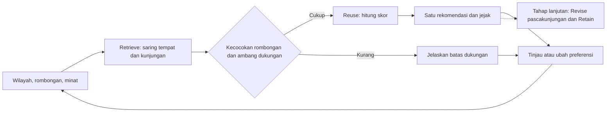

# Metodologi dan evaluasi Tourguider

## Satu kasus kunjungan

Satu kasus menyimpan konteks perjalanan yang tercatat (rombongan, wilayah, kategori, bulan, tahun), objek yang dikunjungi, serta rating pengalaman 1–5. Wilayah dan kategori berasal dari katalog tempat. Preferensi yang dinyatakan sebelum kunjungan historis tidak tersedia. Dataset dipakai untuk demonstrasi CBR melalui Retrieve dan Reuse. [Tourism Dataset Mendeley v1, Choirul Huda, CC BY 4.0](https://doi.org/10.17632/h58s544674.1)

Dari 52.930 transaksi, pembersihan membuang 3.722 duplikat dan 2.052 baris konflik. Tersisa **47.156 kunjungan**. Tiga tempat dikeluarkan dari rekomendasi sesuai kebijakan lama (83 + 31 + 53 kunjungan), sehingga **46.989 kunjungan aktif** mencakup **32.915 pengulas unik**, **27 tempat**, dan **45.811 kelompok pengulas–tempat–rombongan**. Bali menyumbang 43.014, Yogyakarta 3.315, dan Malang 660 kunjungan aktif. Seluruh kasus bersih tetap disimpan pada artefak lokal. SHA-256 kasus menggunakan ID transaksi sumber dan namespace Mendeley v1. Referensi pengulas berupa ordinal lokal snapshot. Keduanya hanya ada di server. [Baseline dan checksum](cbr-baseline.json)

## Alur CBR dan metrik



| Tahap | Masukan dan proses | Keluaran dan ukuran |
|---|---|---|
| Input | Satu jawaban tiap kelompok. | 4 opsi wilayah × 5 rombongan × 6 minat = 120 kombinasi, termasuk opsi yang ditandai tidak tersedia. |
| Retrieve | Wilayah dan kategori menyaring katalog. Alam mencakup air terjun. | Hitung kunjungan dan pengulas unik lintas tempat yang masuk filter, lalu hitung keduanya untuk rombongan yang cocok. |
| Similarity | Rombongan sama bernilai 1, lainnya 0. Ambang kecocokan 1. | Histogram kunjungan 0/1 di dalam katalog tersaring. Tipe rombongan adalah label kategoris dan sumber tidak mendukung bobot kemiripan antartipe. |
| Reuse | Satu nilai rata-rata per pengulas untuk setiap tempat dan rombongan. Prior historis merata-ratakan kunjungan per pengulas lintas rombongan, lalu merata-ratakan nilai tiap pengulas. | Hitung jumlah pengulas unik per kandidat. Ambang dukungan terpilih 5. Smoothing tetap 10. |
| Recommendation | Hitung `(n × rata-rata serupa + k × rata-rata historis) / (n + k)`. Urutkan menurut skor, pengulas serupa, lalu ID terkecil. | Satu tempat atau alasan bukti kurang. Coverage = kombinasi dengan hasil / total. Kandidat tunggal = hasil dengan satu kandidat / kombinasi yang punya hasil. Frekuensi pemenang dan jumlah nama unik dihitung dari hasil yang tersedia. |
| Ubah preferensi | Bandingkan dua hasil terakhir yang berbeda pada sesi browser. | Jejak sebelum–sesudah menunjukkan pilihan, kasus cocok, kandidat masuk/keluar, skor, dan destinasi. Audit sintetis menghitung pasangan yang berbeda tepat satu jawaban dan memisahkan pergantian nama dari perubahan status dukungan. Pengukuran revisi pengguna nyata memerlukan data penggunaan dengan persetujuan. |
| Revise dan Retain | Rancangan umpan balik pascakunjungan, validasi, lalu simpan kasus yang layak. | Revise dan Retain pascakunjungan berada pada tahap lanjutan. Ukuran Retain kelak adalah jumlah kasus tervalidasi yang tersimpan dan ditemukan kembali pada pencarian yang sesuai. |

## Evaluasi sebelum dan sesudah

A adalah rata-rata historis tempat, B agregasi lama 10/10, dan C perhitungan kasus individual. Pada konfigurasi **10/10**, B dan C setara pada **120/120 kombinasi**, termasuk kandidat, urutan pemenang, dan prediksi pada holdout. Perbedaan skor terbesar hanya **1,78 × 10⁻¹⁵**. Pada v4, batas dukungan 5 dipilih dari validasi, sehingga kombinasi baru dapat lolos.

Uji akhir memakai 6.583 pengulas yang ditahan dengan seed 42. Di dalam data pengembangan, seed 43 memisahkan 21.066 pengulas latih dan 5.266 validasi. Ambang 3/5/10/15 dan smoothing 0/5/10/20 menghasilkan 16 konfigurasi. Ambang 3 dan 5 dengan smoothing 10 sama-sama lolos: coverage validasi per wilayah terjaga, coverage Malang naik dari 16 ke 21, dan interval bootstrap perubahan MAE pada kasus yang sama adalah [0, 0]. Ambang 5 dipilih karena lebih dekat ke 10 pada coverage dan MAE yang setara. Pada kasus yang baru lolos, jumlah bukti lebih sedikit dan pengaruh prior relatif lebih besar.

| Metrik | Sebelum B | Sesudah C | Perubahan dan interpretasi |
|---|---:|---:|---|
| MAE pada 9.201 kasus yang sama | 0,725019 | 0,725019 | Setara. A = 0,724027. |
| RMSE pada 9.201 kasus yang sama | 0,924389 | 0,924389 | Setara. A = 0,923514. |
| Coverage prediksi rating | 9.201/9.225 | 9.216/9.225 | Bertambah 15 kasus uji. A mencakup 9.225. |
| Coverage rekomendasi | 96/120 | 100/120 | Bertambah empat kombinasi di Malang. |
| Rata-rata kandidat lolos per kombinasi | 3,88 | 4,18 | Termasuk kombinasi tanpa hasil. |
| Destinasi unik yang menang | 18 | 17 | Perubahan dukungan dapat menggeser pemenang. |
| Kasus konsultasi tanpa hasil | 24 | 20 | Kondisi tanpa hasil tetap terlihat. |
| Keterlacakan | Ringkasan agregat dan sampel rating | Kumpulan kasus individual, nilai pengulas, prior, dan kandidat | Skor dapat dihitung ulang. Sampel diambil dari kelompok yang masuk perhitungan. |

| Wilayah input | Coverage sebelum → sesudah | Kandidat tunggal sebelum → sesudah | Pemenang unik sebelum → sesudah | MAE / RMSE B dan C pada kasus sama |
|---|---:|---:|---:|---:|
| Bali | 25/30 → 25/30 | 10 → 10 | 7 → 7 | 0,72548 / 0,92562 (8.516) |
| Yogyakarta | 24/30 → 24/30 | 11 → 11 | 6 → 6 | 0,74548 / 0,93843 (589) |
| Malang | 17/30 → 21/30 | 7 → 9 | 5 → 4 | 0,55846 / 0,70184 (96) |
| Semua wilayah | 30/30 → 30/30 | 8 → 6 | 8 → 9 | Pengukuran rating mengikuti wilayah tempat yang tercatat. |

Uji perubahan satu jawaban pada matriks sesudah optimasi menghasilkan **96 pergantian tempat dan 48 perubahan status** dari 180 pasangan perubahan wilayah, **55 dan 18** dari 240 pasangan perubahan rombongan, serta **188 dan 84** dari 300 pasangan perubahan minat. Pasangan dihitung tanpa arah. JSON menyimpan rincian per wilayah dan frekuensi tiap pemenang.

Stabilitas memakai 100 bootstrap pengulas dengan seed 45. Semua catatan pengulas diambil bersama. Frekuensi bootstrap membobot rerata, sedangkan ambang tetap memakai jumlah pengulas berbeda yang ikut sampel. Rata-rata retensi pemenang untuk skenario yang awalnya punya hasil adalah Bali **87,2% → 89,4%**, Yogyakarta **79,7% → 87,0%**, Malang **76,8% → 78,1%**, dan Semua wilayah **80,9% → 71,1%**. Angka sebelum dan sesudah mencakup himpunan skenario yang masing-masing punya hasil. Penurunan pada Semua wilayah merupakan trade-off konfigurasi yang dipilih.

MAE dan RMSE hanya mengukur prediksi rating tempat yang telah dikunjungi. Dataset tidak memberi rating tempat yang belum dikunjungi, label relevansi konsultasi baru, atau penilaian independen terhadap kualitas penjelasan. Audit penjelasan memeriksa konsistensi dengan data dan rumus, sementara relevansi serta kegunaan untuk pengguna memerlukan penilaian terpisah. [Matriks 120 kombinasi, sensitivitas, dan hasil uji](cbr-evaluation.json)

## Panduan presentasi

1. Pilih **Malang → Teman → Air terjun**. Ada 55 kunjungan di tempat yang memenuhi wilayah dan minat, dengan 21 kunjungan dari 21 pengulas yang cocok dengan rombongan Teman.
2. Sistem memberi **Air Terjun Coban Rondo** karena hanya tempat itu yang memenuhi batas dukungan. Buka Alur CBR. Tiga contoh memberi rating **4, 3, dan 5** dan berasal dari kumpulan yang dipakai.
3. Tunjukkan perhitungan `(21 × 3,9047619047619047 + 10 × 3,9814814814814814) / 31 = 3,9295101553166067`. Buka peta dan catatan akses dari kartu hasil. Peta mencari nama tempat, dan informasi operasional perlu dikonfirmasi ke pengelola.
4. Gunakan **Ubah preferensi** ke **Yogyakarta → Keluarga → Gunung dan vulkanologi**. Gunung Merapi didukung 223 kunjungan dari 189 pengulas. Tampilkan perbandingan sebelum–sesudah di Alur CBR.
5. Tunjukkan **Bali → Gunung dan vulkanologi** yang tidak tersedia, lalu jelaskan perbedaan antara pilihan tidak tersedia dan hasil berdukungan rendah. Akhiri dengan angka coverage dan MAE. Peningkatan yang terukur adalah keterlacakan dan jumlah kombinasi berdukungan, sementara keunggulan akurasi belum terbukti.

## Implementasi dan reproduksi

- `backend/cases.py` membangun indeks dan jejak dari kasus individual. `backend/engine.py` menjadi pembanding agregat lama.
- `backend/evaluate_cbr.py` mereproduksi baseline, menjalankan sensitivitas serta holdout, dan membuat artefak privat lokal. `backend/app.py` menghubungkan indeks dukungan, konsultasi, dan versi artefak. Frontend menggunakan respons yang sama untuk hasil dan Alur CBR.
- Tes meliputi perhitungan pengulas berulang, ambang dan seri, artefak fallback, serta konsistensi bukti dengan basis kasus. Jalankan dari folder proyek:

```sh
python -m pip install -r requirements-dev.txt
python -m backend.evaluate_cbr --source /lokasi/Excel --output docs/cbr-baseline.json
python -m backend.evaluate_cbr --source /lokasi/Excel --output docs/cbr-evaluation.json --artifact artifacts/cbr-cases-v4.json
python -m pytest -q
```

Baseline membaca artefak lama `artifacts/cbr.json`. Jika diperlukan, bangun dengan `python -m backend.train --source /lokasi/Excel` sebelum membekukan baseline. Artefak v4 lokal diabaikan Git agar referensi internal tetap di server. `/api/health` membedakan basis individual dari ringkasan lama.
