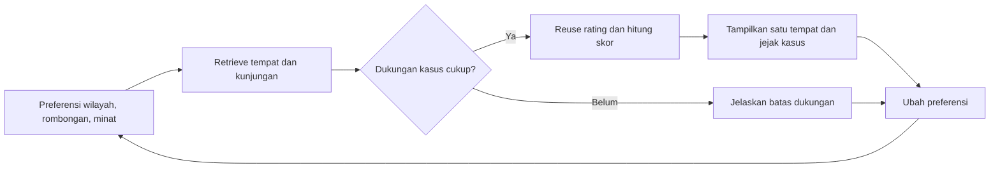

# Panduan demo Tourguider

## Tujuan demo

Tunjukkan bagaimana preferensi pengguna membatasi kumpulan kasus, bagaimana rating kasus serupa dihitung, dan mengapa satu tempat menjadi rekomendasi akhir. Aplikasi menggunakan riwayat kunjungan dan rating dari Tourism Dataset Mendeley v1.

## Sebelum presentasi

1. Jalankan Tourguider melalui `./run.command` atau perintah pada README.
2. Pastikan `/api/health` menunjukkan `evidence_type` **individual**. Jika tertulis **legacy_summary**, halaman masih memakai ringkasan agregat dan belum menampilkan seluruh jejak kasus individual.
3. Buka halaman utama dan siapkan halaman **Alur CBR** pada tab browser yang sama agar hasil konsultasi dapat dibuka langsung.

## Demo utama

Pilih **Malang → Teman → Air terjun**.

1. Tunjukkan pertanyaan konsultasi. Wilayah dan minat membatasi objek wisata yang dipertimbangkan, sedangkan tipe rombongan menentukan kasus yang dianggap serupa.
2. Hasil yang diharapkan adalah **Air Terjun Coban Rondo**.
3. Buka **Lihat alur CBR**. Tunjukkan bahwa 55 kunjungan berada pada cakupan tempat, wilayah, dan minat tersebut. Dari jumlah itu, 21 kunjungan oleh 21 pengulas unik cocok dengan tipe rombongan Teman.
4. Tunjukkan tiga contoh rating yang berkontribusi, yaitu **4/5, 3/5, dan 5/5**. Contoh hanya sebagian dari 21 pengulas yang dipakai. Rating yang tampil adalah nilai historis, bukan perkiraan rating pengguna sekarang.
5. Jelaskan bahwa hanya Coban Rondo yang memenuhi ambang minimal 5 pengulas serupa. Skor menggabungkan rata-rata rating kasus serupa **3,9048/5** dengan rata-rata historis tempat **3,9815/5**. Perhitungannya `(21 × 3,9048 + 10 × 3,9815) / (21 + 10) = 3,9295/5`.
6. Kembali ke kartu hasil. Tunjukkan tautan peta dan informasi akses. Peta mencari nama tempat, sementara kondisi operasional tetap perlu dikonfirmasi kepada pengelola.

## Perbandingan preferensi

Gunakan **Ubah preferensi** dan pilih **Yogyakarta → Keluarga → Gunung dan vulkanologi**. Hasil yang diharapkan adalah **Gunung Merapi**. Pada Alur CBR, tunjukkan 223 kunjungan, 189 pengulas serupa, rating yang ditampilkan sebagai contoh, dan komponen skor. Fitur perbandingan menunjukkan perubahan jumlah kasus, kandidat, skor, dan tempat setelah preferensi diubah.

## Contoh ketika belum ada hasil

Pilih **Bali → Gunung dan vulkanologi**. Aplikasi menjelaskan bahwa kombinasi tersebut belum memiliki tempat dalam katalog yang memenuhi pilihan. Tunjukkan bahwa pilihan yang tidak tersedia dinonaktifkan atau diberi catatan, sehingga pengguna tahu preferensi perlu diubah.

## Alur CBR untuk dijelaskan

**Retrieve** menyaring tempat berdasarkan wilayah dan kategori. **Similarity** memberi nilai 1 pada tipe rombongan yang sama dan 0 pada tipe lain. **Reuse** menghitung rata-rata rating per pengulas, lalu menggabungkan rata-rata kelompok serupa dengan rata-rata historis tempat. Tempat dengan skor tertinggi menjadi hasil. Bila skor seri, sistem memakai jumlah pengulas serupa lalu ID tempat sebagai pemutus seri.

**Revise** dan **Retain** merupakan tahap lanjutan. Versi demo belum meminta pengguna menilai perjalanan setelah kunjungan, sehingga belum mengubah hasil atau menyimpan pengalaman baru sebagai kasus.

## Hal yang perlu disampaikan

- Rekomendasi mengikuti kasus kunjungan terdahulu dan rating yang tersedia pada dataset.
- Jumlah kunjungan dan jumlah pengulas unik berbeda. Kunjungan berulang oleh orang yang sama diringkas agar tidak dihitung sebagai pengulas berbeda.
- MAE dan RMSE pada laporan mengukur prediksi rating untuk tempat yang pernah dikunjungi. Keduanya tidak membuktikan kepuasan atau relevansi tempat bagi pengguna baru.
- Beberapa pilihan dapat menghasilkan lebih dari satu kandidat, atau belum menghasilkan kandidat. Cakupan data membatasi keluaran sistem.
